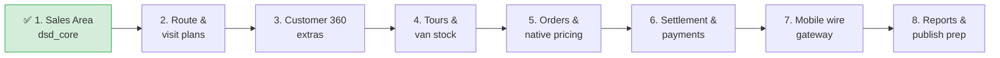

# DSD on Odoo — Architecture Diagrams (Mermaid)

Companion to the implementation-plan issue on `omidcsh/odoo-dsd`.
Solid arrows/lines = built (step 1). Dashed = planned, one step per issue.

## 1. Data model — DSD entities and their Odoo relationships

```mermaid
erDiagram
    ORG["dsd.sales.org"] ||--o{ AREA["dsd.sales.area"] : "sales_org_id"
    CHN["dsd.distribution.channel"] ||--o{ AREA : "dist_channel_id"
    DIV["dsd.division"] ||--o{ AREA : "division_id"
    PARTNER["res.partner"] ||--o{ PSA["dsd.partner.sales.area"] : "partner_id"
    AREA ||--o{ PSA : "sales_area_id (unique per customer)"
    WH["stock.warehouse"] ||--o{ PSA : "plant_id"
    PL["product.pricelist"] ||--o{ PSA : "pricelist_id (syncs to partner)"
    PARTNER ||--o{ PSA : "payer / sold_to / ship_to / bill_to"

    AREA {
        char sales_org_id "VKORG catalog ref"
        char dist_channel_id "VTWEG catalog ref"
        char division_id "SPART catalog ref"
        bool active "archive hides from download"
    }
    PSA {
        bool sale_block "blocks docs, row stays"
        bool delivery_block "wire DELV_BLOCK2"
        bool billing_block "wire BILL_BLOCK2"
        bool active "row leaves download"
    }

    AREA ||..o{ ORDER["sale.order (stamp)"] : "sales_area_id — planned"
    AREA ||..o{ ROUTE["dsd.route"] : "scope — planned"
    PSA ||..o{ RCUST["dsd.route.customer"] : "membership — planned"
    ROUTE ||..o{ PLAN["dsd.visit.plan"] : "planned"
    PLAN ||..o{ TOUR["tour on stock.picking.batch"] : "planned"
    GW["dsd_compatibility gateway"] ||..|| AREA : "emits MSE_* registry — planned"
```

## 2. Build roadmap — one step per issue



## Notes

- Pricing decision (D5): Odoo-native `product.pricelist` on the Odoo side;
  the SAP parity engine (`dsd_pricing`) is dropped — device keeps its own
  offline engine when the gateway step arrives.
- Every step follows the standing rules: survey Odoo-native first, plan as an
  issue, build one small slice (models+views+security+tests), stop and report.
- Detailed per-step plan docs live in the monorepo at `docs/plans/`.
