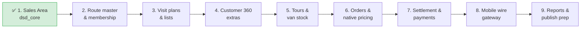

# [PLAN] DSD (Direct Store Delivery) on Odoo — Implementation Plan

**Goal:** bring SAP-style DSD to Odoo step by step, as a publishable module
suite. Source material: the SAP-DSD-to-ODOO engineering package (Solico) —
adapted by the decisions below. This issue is the master plan; **each step
gets its own issue**, and nothing is implemented without a plan issue first.

## Ground rules (agreed)

1. **Step by step** — one small vertical slice per step (models + views +
   security + tests), verified and committed, then stop. Never build the
   whole app in one go.
2. **Odoo standard first** — before any feature, survey what Odoo 20 core
   already offers; extend only the missing parts. Custom models must
   reference the SAP/DSD concept they replace.
3. **Plan before code** — each step starts as an issue with scope, native
   survey, deferred list, and tests to write.
4. **Publishable hygiene** — LGPL-3, clean field names, lean `depends`,
   Odoo 20 formats (`ir.access.csv`, `res.groups.privilege`,
   `models.Constraint`, `<list>` views).

## Decisions log

| # | Decision | Outcome |
|---|---|---|
| D1 | Module technical name | `dsd_core` (package specs reference it) |
| D2 | Demo data | none until the suite is usable end-to-end |
| D3 | Field naming | clean `dsd_*` names (comments link IMPL `x_` names) |
| D4 | payment_terms1..5 wire slots | deferred with other wire fields |
| D5 | Pricing engine | **Odoo-native `product.pricelist`** on the Odoo side; SAP parity engine (`dsd_pricing`, Phase 6 of the package) dropped; device keeps its offline engine |
| D6 | Sales-area trio | master catalogs + TVTA-style combo entity + relationship row (not free chars) |

## Data model & roadmap diagrams

See `docs/dsd-architecture.md` in the monorepo (Mermaid; also below).

## Steps (checklist — each becomes its own issue when started)

- [x] **1. Sales Area entities** — org/channel/division catalogs, valid-combo
  entity, customer relationship row, partner tab, Odoo-native plant/pricelist
  links (#2 — dev task; reference impl on `feature/dsd-core`, 9 tests green)
- [ ] **2. Route master & membership** — `dsd.route` (weekday pattern,
  warehouse, drivers, SA scope) + ordered customer membership (#3)
- [ ] **3. Visit plans (strategic layer)** — plan types, plans, weekday
  lines (#4); lists + generation deferred to step 5
- [ ] **4. Customer 360 extras** — hierarchy, geo fields, blocks propagation
  (wire passthroughs join here or at the gateway step, only when consumed)
- [ ] **5. Tours, visit lists & van stock** — tours on
  `stock.picking.batch`, visit lists + generation machinery (M01 §3.5–3.6),
  van as stock location, check-out/in day cycle
- [ ] **6. Orders & native pricing** — `sale.order` capture stamped with
  sales area; pricelist flows from the primary SA (D5)
- [ ] **7. Settlement & payments** — COCI settlement, `account.payment`
  cash/cheque capture
- [ ] **8. Mobile wire gateway** — `dsd_compatibility`: the 3 endpoints,
  `zcheck_user`, download emitters (wire fields materialize here),
  upload ingest keyed on (guid, object, business key)
- [ ] **9. Reports & publish prep** — QWeb reports, README/icon, suite
  packaging, license pass

## References

- Engineering package (SAP-DSD-to-ODOO): architecture, wire registry
  (`mse-object-registry.csv`, 132 objects), M01–M13 business specs
- Monorepo plan docs: `docs/plans/2026-11-18-sales-area.md` (v2.1),
  `docs/odoo20-dev-handoff.md` (incl. 19→20 port gotchas table)
