# [PLAN] DSD (Direct Store Delivery) on Odoo — Implementation Plan

**Goal:** build an **SAP-inspired DSD platform** on Odoo (business-process
compatibility with SAP DSD; technical/wire compatibility dropped per D8),
step by step, as a publishable module
suite. Source material: the SAP-DSD-to-ODOO engineering package (Solico) —
adapted by the decisions below. This issue is the master plan; **each step
gets its own issue**, and nothing is implemented without a plan issue first.

## Ground rules (agreed)

1. **Step by step** — one small vertical slice per step (models + views +
   security + tests), verified and committed, then stop. Never build the
   whole app in one go.
2. **Odoo standard first** — before any feature, survey what Odoo 20 core
   already offers; extend only the missing parts. Custom models must
   reference the SAP/DSD concept they replace.
3. **Plan before code** — each step starts as an issue with scope, native
   survey, deferred list, and tests to write.
4. **Publishable hygiene** — LGPL-3, clean field names, lean `depends`,
   Odoo 20 formats (`ir.access.csv`, `res.groups.privilege`,
   `models.Constraint`, `<list>` views).
5. **Pre-post consistency checklist** (added after review rounds 1–2 —
   every spec issue is checked against it before posting/updating):
   grep the corpus for superseded wording after any decision; every named
   model ↔ providing module ↔ `depends`; concurrency invariants get
   DB-level enforcement (partial unique indexes, not python-only guards);
   business rules must survive the "successful visit with zero orders"
   scenario; ONE auth mechanism with identity from the session and
   per-role server-side data visibility; every client mutation idempotent
   (retries return the original result, never an error); unique
   constraints have no NULL holes; all enum values and codes defined;
   issue↔roadmap↔diagram numbering consistent; Odoo-20-specific syntax
   verified against the local source tree.

## Decisions log

| # | Decision | Outcome |
|---|---|---|
| D1 | Module technical name | `dsd_core` (package specs reference it) |
| D2 | Demo data | none until the suite is usable end-to-end |
| D3 | Field naming | clean `dsd_*` names (comments link IMPL `x_` names) |
| D4 | payment_terms1..5 wire slots | deferred with other wire fields |
| D5 | Pricing engine | **Odoo-native `product.pricelist`** on the Odoo side; SAP parity engine (`dsd_pricing`, Phase 6 of the package) dropped; device keeps its offline engine |
| D6 | Sales-area trio | master catalogs + TVTA-style combo entity + relationship row (not free chars) |
| D9 | Architecture review adoption (2026-11-18, external review — verdicts in `docs/reviews/2026-11-18-architecture-review.md`) | Pricing resolves from the **visit/order's SA** at creation time (partner-property sync dropped); vehicle optional in presales (+ `fleet` dep); visit lifecycle independent of orders; visit list has one explicit `source_type`; 1-live-tour-per-list DB-enforced (partial unique index); mobile auth = session-only v1 + new `group_dsd_driver` role; day package bounded + paginated `/catalog`; idempotency on every verb (download = find-or-materialize); returns = flagged orders with POSITIVE qty (fulfilment deferred); prices endpoint takes visit/SA context; `dsd.customizing` gets value_type + per-scope partial uniques + config_version; API = plain JSON over HTTP with `{ok,…}` envelope; `mail` dep adopted for audit; `company_id` anchors on SA models. **Round-2 refinements (2026-11-18):** SA combo unique becomes `(company, org, chn, div)` — same trio MAY exist in different companies; partner-SA `company_id` must match its combo; primary = **at most one** active per (partner, company), optional not mandatory, DB partial-unique-indexed; mobile security = controller-level driver scoping (`driver_id = uid`, never client-writable) + cross-driver tests, record rules where Odoo 20 `ir.access` domains allow; returns marked **interim** pending step 7's goods-receipt/credit-note design; audit = tracked fields (old/new/user/time) on visit states, skips, cancels, tour reset, geo changes |
| D11 | Step-5 business rules FINAL (2026-11-19, critical review of the external 7-phase program — adopted with verdicts, not verbatim) | Pricing strictly from the visit's SA pricelist with **NO automatic fallback** (missing pricelist blocks order — corrects D9's earlier partner-property fallback chain, which could silently price with another SA's list); empty list cannot download; downloaded list is READ-ONLY (unlock restores edit); materialization is ATOMIC; visit transition matrix explicit (planned→arrived→done/skipped; done/skipped terminal); SA `sale_block` guards order creation; cancel-tour is its own transition with mandatory reason; list/tour/visit carry `company_id` |
| D10 | Weekday pattern location (2026-11-18, verified against standard SAP) | **Plan-only (a-refined).** Weekday pattern lives on the visit-plan HEADER (mask, mon–fri default) with an optional per-line override; `dsd.route` carries NO weekday fields. Matches standard `/DSD/VC_VPH` (MON..SUN on header) + `/DSD/VC_VPP` (per-line rule); no standard/Z route master has weekdays |
| D8 | Mobile (2026-11-18, user; refined same day) | **New native Android/iOS app + clean Odoo JSON API.** v1 assumes **everything online** — every read and write is a live server call; pricing is server-computed (ask Odoo, get the result — extends D5). The SAP wire-compatibility mission (pseudo-SAP gateway, MSE_* registry, dsd_compatibility module) is DROPPED — the SAP package is business-logic reference only. Sales scenario first, distribution second; backend/API equipped first. Mobile features named so far: tour/visit/customer/product/config/customizing/pricing downloads; order + return uploads; visit data upload; **cancel & copy** on orders. **Config/customizing:** behavior changeable via config — model `dsd.customizing` (key/value, scope resolution global → country → sales area), semantics mined from the old app source at `/Users/kalleh/Source/Solico/MDSD` (CustomizingConstants ~75 global keys + CustomizingSalesAreaBO 68 per-SA flags) |
| D7 | Tour birth (2026-11-18, user) | **On-demand tour from visit list.** The visit list is the day's planning unit; the tour is materialized at download time (release = download), 1:1 with a download lock. Unlock only by admin logical-delete of the tour, guarded: (a) no uploaded/linked documents on the tour, (b) the new tour gets a new id (never reuse), (c) archived tour kept with reason. List content is snapshotted into the tour at creation (later list changes don't propagate). SAP batch-generation machinery, parity message codes 300–316 and the NAST/IDoc chain are dropped; list ladder: `draft → downloaded → closed` |

## Data model & roadmap diagrams

See `docs/dsd-architecture.md` in the monorepo (Mermaid; also below).

```mermaid
flowchart LR
    S1["✅ 1. Sales Area<br/>dsd_core"]
    S2["2. Route master<br/>& membership"]
    S3["3. Visit plans<br/>& lists"]
    S4["4. Customer 360<br/>extras"]
    S5["5. Presales day<br/>list→tour→visits→orders"]
    S6["6. Mobile API v1<br/>(sales)"]
    S7["7. Monitoring console<br/>tours·map·orders"]
    S8["8. Delivery prep<br/>+ mobile delivery"]
    S9["9. Van sales<br/>(ON HOLD)"]
    S10["10. Settlement &<br/>payments"]
    S11["11. Reports &<br/>publish prep"]
    S1 --> S2 --> S3 --> S4 --> S5 --> S6 --> S7 --> S8 --> S9 --> S10 --> S11
    style S1 fill:#d4edda,stroke:#28a745
```

## Steps (checklist — each becomes its own issue when started)

- [x] **1. Sales Area entities** — org/channel/division catalogs, valid-combo
  entity, customer relationship row, partner tab, Odoo-native plant/pricelist
  links (#2 — dev task; reference impl on `feature/dsd-core`, 9 tests green)
- [ ] **2. Route master & membership** — `dsd.route` (weekday pattern,
  warehouse, drivers, SA scope) + ordered customer membership (#3)
- [ ] **3. Visit plans (strategic layer)** — plan types, plans, weekday
  lines (#4); lists + generation deferred to step 5
- [ ] **4. Customer 360 — DSD panel** — routes read-through + geo/city
  master fields on the partner form (#5); geo codes interim — **Geographic
  Master Data (P1)** replaces them with m2o hierarchy when built
- [ ] **5. Presales day (D7/D9)** (#6) — light visit list → on-demand tour
  materialization (1:1, snapshot, admin unlock) → visits → presale orders
  (`sale.order` per visit, **pricelist from the VISIT's SA**, never the
  partner-level primary); deps +sale/fleet/mail. Order capture and native
  pricing live HERE (formerly a separate step — merged).
- [ ] **6. Mobile API v1 (D8/D9)** (#7) — JSON-over-HTTP, session-only auth,
  `group_dsd_driver` role, idempotent verbs (download = find-or-materialize),
  paginated `/catalog`, prices in visit-SA context, cancel & copy,
  positive-qty interim returns
- [ ] **7. Back-office monitoring console** (user 2026-11-19, before
  distribution) — tours overview + statuses + progress, salesmen on a live
  map (Leaflet; web_map is Enterprise), orders per salesman; post-tour
  backend rules (chatter summary, no auto-confirm)
- [ ] **8. Delivery preparation & mobile delivery** (user 2026-11-19:
  no money yet) — delivery RUNS on `stock.picking.batch` from confirmed
  presale orders (route+date+driver); mobile API v1.3: run download,
  stop confirm (partial→backorder), fail-with-reason, doorstep returns
  with reference invoice; no van stock, no invoicing
- [ ] **9. Van sales (distribution material)** *(draft ON HOLD 2026-11-19)* —
  van stock/loading/COCI/reload + return fulfilment (goods receipt, credit
  note) — released when the user un-holds
- [ ] **10. Settlement & payments** — COCI settlement, `account.payment`
  cash/cheque capture (when sales starts collecting money)
- [ ] **11. Reports & publish prep** — QWeb reports, README/icon, suite
  packaging, license pass

## References

- Engineering package (SAP-DSD-to-ODOO): architecture, wire registry
  (`mse-object-registry.csv`, 132 objects), M01–M13 business specs
- Monorepo plan docs: `docs/plans/2026-11-18-sales-area.md` (v2.1),
  `docs/odoo20-dev-handoff.md` (incl. 19→20 port gotchas table)
